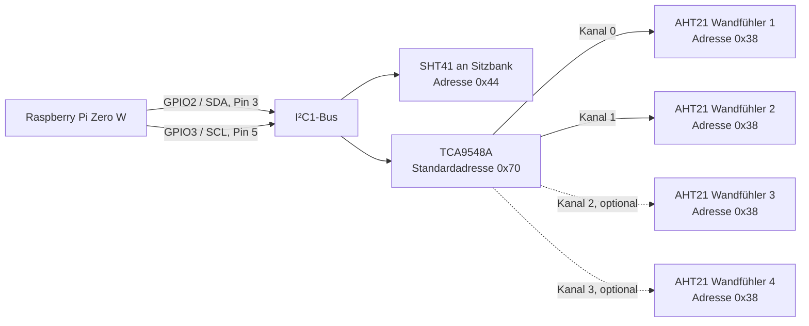

# Anschluss- und Verdrahtungsplan

BCM ist die GPIO-Nummer im Programm. „Pin“ bezeichnet die physische Position am 40-poligen Header. Vor Verdrahtung die Orientierung des Headers prüfen. Der Plan beschreibt den Stand mit optionalen AHT21-Wandfühlern aus Software v0.3.0.

## Übersicht

Die zwei I²C-Leitungen bilden einen gemeinsamen Bus: SHT41 und TCA9548A hängen parallel an SDA/SCL. Die AHT21 hängen jeweils an einem eigenen, nachgeschalteten TCA9548A-Kanal. Die gestrichelten Kanäle sind optional. So können gleich adressierte AHT21 getrennt angesprochen werden.

| Anschluss | BCM | Physischer Pin | Bedeutung |
|---|---:|---:|---|
| Koppelrelais für K1 | 17 | 11 | Aktive Heizanforderung, standardmäßig HIGH |
| Koppelrelais für K2 | 27 | 13 | Aktive Heizanforderung, standardmäßig HIGH |
| Koppelrelais Aufgussventil | 16 | 36 | Ausgang vorgesehen, bleibt in der aktuellen Software AUS |
| Koppelrelais Verdampfer-Nachfüllventil | 20 | 38 | Ausgang vorgesehen, bleibt in der aktuellen Software AUS |
| Spiegelkontakt K1 | 22 | 15 | HIGH = Öffner geschlossen, K1 abgefallen |
| Spiegelkontakt K2 | 23 | 16 | HIGH = Öffner geschlossen, K2 abgefallen |
| MAX31865 MOSI / SDI | 10 | 19 | SPI0 MOSI |
| MAX31865 MISO / SDO | 9 | 21 | SPI0 MISO |
| MAX31865 CLK | 11 | 23 | SPI0 SCLK |
| MAX31865 CS | 8 | 24 | SPI0 CE0 |
| SHT41 SDA und TCA9548A SDA | 2 | 3 | Gemeinsamer I²C1 SDA; SHT41 standardmäßig 0x44 |
| SHT41 SCL und TCA9548A SCL | 3 | 5 | Gemeinsamer I²C1 SCL |
| Lichttreiber | 18 | 12 | HIGH = Licht EIN; in V1 keine Dimmung |
| Externer Watchdog | 24 | 18 | Wechselndes Lebenszeichen, ungefähr 5 Hz |
| STB-/STOP-Kreis Diagnose | 25 | 22 | HIGH = unabhängiger Sicherheitskreis bereit |
| Freigabe-/Reset-Taster | 5 | 29 | HIGH bei Tastendruck |
| Türdiagnose | 6 | 31 | HIGH = Tür geschlossen |
| 3,3 V | — | 1 oder 17 | Nur passende stromarme Sensor-/Logikversorgung |
| Masse | — | z. B. 6, 9, 14, 20, 25, 30, 34, 39 | Kleinspannungs-Logikmasse |

**Kein GPIO darf 5 V, 12 V, 24 V oder Netzspannung erhalten.** Keine Spule und keine LED-Leistung direkt an einen GPIO anschließen. Koppelrelais über geeignete 3,3-V-Treiber betreiben; Schützspulen erhalten ihre eigene, passend abgesicherte Versorgung. Falls die Relaismodule LOW-aktiv sind, muss `relay_active_high` zur realen Baugruppe passen. Ein Softwareparameter verhindert keine Einschaltimpulse beim Boot: Die Treiber müssen den AUS-Zustand ohne laufenden Pi hardwareseitig sicherstellen.

Die Eingänge haben im Programm Pull-down. Ein tatsächlich potentialfreier, ausschließlich für den Pi genutzter Kontakt kann 3,3 V zum Eingang schalten. Bei Feldspannung, gemeinsamem Sicherheitskreis oder langen Leitungen eine geeignete galvanisch getrennte Eingangsstufe einsetzen. Keine parallele Pi-Verdrahtung an spannungsführende Hilfskontaktkreise. Ein gewöhnlicher Schließer-Hilfskontakt erfüllt nicht automatisch die Anforderung an einen Öffner-Spiegelkontakt.

GPIO25 ist nur Diagnose. STB und lokaler STOP müssen die Schützspulen unabhängig vom GPIO und Prozess unterbrechen können. Der externe Watchdog muss Flanken auswerten und bei ausbleibendem Signal die Hardwarefreigabe entziehen. Sein Signal wird nur nach erfolgreichen Hauptschleifendurchläufen erzeugt, nicht durch einen unabhängig weiterlaufenden PWM-Generator. Ohne gültigen PT100, bei Fehler oder offener Tür wird das Signal nicht fortgeführt.

Der Türkontakt ist eine zusätzliche V1-Startsperre; er ist keine pauschal freigegebene Fernstarteinrichtung für einen beliebigen Ofen. Für Hardwarebetrieb sind zusätzlich die im Implementierungsplan beschriebenen unabhängigen Schutzfunktionen erforderlich.

## PT100

Der PT100 wird an den RTD-Klemmen des MAX31865 angeschlossen, nicht am GPIO. Standard ist 4-Leitertechnik mit `rtd_wires = 4` und einem beispielhaften Referenzwiderstand von `430.0` Ohm. Beides vor Betrieb anhand von Fühler, Modul und dessen Brückenstellung verifizieren. Die Modulversorgung und alle SPI-Pegel müssen zum Pi passen. MAX31865 außerhalb der Kabine montieren und SPI-Leitungen kurz halten.

## SHT41

Nur ein für die vorhandene 3,3-V-Logik geeignetes Modul verwenden. Pull-ups dürfen den Bus nicht auf 5 V ziehen. Bei langen Leitungen Buskapazität und Übertragung prüfen; gegebenenfalls geeignete Extender einsetzen. Der Sensorchip-Betriebsbereich gilt nicht automatisch für das ganze Breakout-Modul. Der Sensorheizer wird in V1 nicht eingeschaltet.

## AHT21-Wandfühler (Software v0.3.0)

Alle AHT21 antworten mit der festen Adresse `0x38`. Mehrere Module dürfen deshalb nicht direkt parallel an SDA/SCL liegen. Einen TCA9548A an denselben I²C1-Bus anschließen (Standardadresse `0x70`) und je einen AHT21 an einen eigenen Multiplexerkanal, zum Beispiel Kanal 0 und 1 für zwei Sensoren oder 0 bis 3 für vier. Für zwei Sensoren `/etc/sauna/controller.toml` auf `aht21_channels = [0, 1]` setzen; für vier Sensoren `aht21_channels = [0, 1, 2, 3]`. Die Multiplexeradresse ist standardmäßig `0x70` (Dezimalwert `112`). Nach der Änderung den Controller neu starten. Pro konfiguriertem Sensor erscheinen Temperatur-, Feuchte- und Taupunktsensoren in Home Assistant.

Multiplexer und AHT21-Module mit 3,3 V versorgen, Masse verbinden und SDA/SCL korrekt führen. Modulbeschaltung und Pull-ups vor dem Anschluss prüfen; am Pi sind nur 3,3-V-I²C-Pegel zulässig. I²C-Leitungen kurz halten und Multiplexer sowie Breakout-Platinen nicht im heißen Saunabereich montieren. Die genaue zulässige Temperatur des kompletten Breakout-Moduls kann niedriger als die des AHT21-Chips sein.

Der angezeigte Taupunkt wird aus Temperatur und relativer Feuchte am jeweiligen AHT21 berechnet. Das meldet die Feuchtebedingungen im Hohlraum; für eine belastbare Kondensationswarnung muss zusätzlich die Temperatur der kältesten Wandoberfläche bekannt sein. Dann lässt sich deren Abstand zum Taupunkt überwachen. Die AHT21 allein messen keine Oberflächentemperatur.

## Banklicht

GPIO18 steuert nur einen geeigneten Logikeingang eines LED-Treibers/MOSFET-Moduls. LED-Leistung über ein dafür ausgelegtes, abgesichertes 12-/24-V-System führen. Erst Spannung und Netzteil-/LED-Art bestätigen. V1 schaltet EIN/AUS. Im Überwachungsmodus sind sämtliche GPIO-Ausgänge, einschließlich Licht, unbenutzt.

## Vorgesehene Wasser-Ausgänge

GPIO16 (Pin 36) ist für das Aufgussventil und GPIO20 (Pin 38) für das Nachfüllventil des Verdampfers reserviert. Beide werden bei Initialisierung ausgeschaltet und von der Regelsoftware dauerhaft ausgeschaltet gehalten. Sie sind noch nicht per Home Assistant schaltbar. Vor einer Aktivierung müssen Ventilspannung und Treiber feststehen sowie eine lokale, zeitbegrenzte Steuerung mit Füllstands-/Überfüllschutz und geeignetem Fehlerverhalten implementiert und geprüft sein. Die Ausgänge niemals direkt mit Ventilspulen verbinden.
